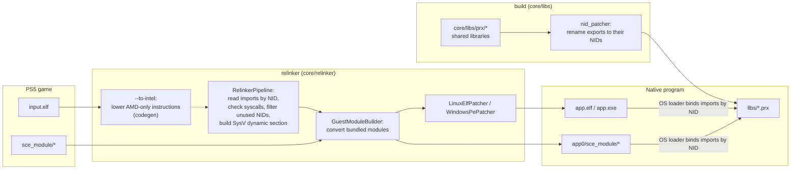
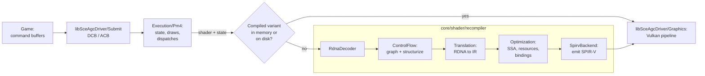

# Architecture

How a PS5 executable becomes a native Linux or Windows program. Nothing is emulated: the converted executable runs as a normal process and calls native implementations of the system libraries.

## Overview

- [`core/relinker/main.cpp`](../../core/relinker/main.cpp) runs the steps in this order. `--to-intel` is optional, see [USAGE.md](../user/USAGE.md).
- Each library in [`core/libs/prx`](../../core/libs/prx) builds as a shared library. After the build, `nid_patcher` ([`core/libs/nid`](../../core/libs/nid)) renames every export to its NID, computed from the function name. `APS5_EXPORT("<nid>", func)` sets the NID directly when the name is unknown.

## Thread cancellation

[`Thread.cpp`](../../core/libs/prx/libkernel/Pthread/src/Thread.cpp) records cancellation requests on the target guest thread. New threads start with cancellation enabled and deferred. A disabled request stays pending; enabling deferred cancellation returns before the next cancellation point acts on it. Repeated requests do not add cleanup invocations.

[`Cancel.hpp`](../../core/libs/prx/libkernel/Pthread/include/Cancel.hpp) connects condition, semaphore and join waits to the request. A canceled condition waiter reacquires its guest mutex before cleanup. Semaphore and join waits release their internal locks before exiting. A request pending on entry to a semaphore wait is acted on before consuming an available token; a canceled join leaves its target joinable and its result output untouched.

Cancellation exits through `scePthreadExit` with result pointer `1`. It runs cleanup handlers in reverse push order before thread-specific destructors; cancellation points inside cleanup must not start another exit. The host thread then terminates through the existing Windows or Linux lifecycle, and join waits for that termination. Host thread termination is not used to inject cancellation into a running guest frame.

The reference contract and constants come from FreeBSD libthr, pinned at [`5ed7eb0d`](https://github.com/freebsd/freebsd-src/blob/5ed7eb0d97ba4436218e810f61bd059acba984c2/lib/libthr/thread/thr_cancel.c), with cleanup and exit ordering in [`thr_exit.c`](https://github.com/freebsd/freebsd-src/blob/5ed7eb0d97ba4436218e810f61bd059acba984c2/lib/libthr/thread/thr_exit.c#L196-L259). These are reference semantics, not console measurements. The supported cancellation points and incomplete asynchronous behavior are listed in [TechnicalDebt](TechnicalDebt.md).

[`GuestPthreadCancelRecovery.cpp`](../../core/libs/tests/GuestPthreadCancelRecovery.cpp) checks pending requests before ordinary and timed semaphore acquisition, cleanup reentrancy and destructor ordering, enabled and disabled timed condition waits, canceled join output, and subsequent resource and thread reuse. Host atomic gates establish pending requests; acquiring the condition mutex after the worker releases it establishes wait entry without a scheduling sleep. Both `guest_pthread_cancel_recovery` and `guest_pthread_cancel_recovery_coarse` retain checks in Release and have a 20-second timeout, shorter than the 60-second guest waits. The latter sets `APS5_COARSE_TIMED_WAITS=1` to exercise the Windows fallback; Linux uses that condition-variable path by default.

## Graphics

- [`Recompiler.cpp`](../../core/shader/recompiler/Recompiler.cpp) runs the stages in this order. With `ANYPS5_ENABLE_SPIRV_TOOLS`, the SPIR-V is also validated and optimized with SPIRV-Tools.
- `ShaderRecompiler::Recompile` keeps compiled variants in memory, and `ShaderDiskCache` stores them on disk so later runs reuse them.
- A compute shader whose LDS plus its lock dword exceeds the host's `maxComputeSharedMemorySize` is not given a `Workgroup` array. `Recompile` sets `ShaderInfo::sharedMemoryBytes` for it and the SPIR-V backend addresses the LDS in a coherent storage buffer at descriptor set 1 (`WorkgroupMemoryDescriptorSet`), with a slice of `RecompileResult::workgroupMemoryDwords` per workgroup, indexed by `WorkgroupID` and `NumWorkGroups`. `VulkanDevice` keeps one such buffer, sized from the dispatch dimensions, and binds it after the resource set; programs that fit keep using shared memory.
- `Driver::RegisterShader` splits shader preparation in two. `PlanRegistered` runs on the registering guest thread: it validates the registers and entry point, decodes the code and builds the recompile request, so invalid registrations still fail there. The RDNA to IR translation and resource plan (`PrepareShader`) run on a background pool of `hardware_concurrency() / 2` detached threads (at least 2, 64 MiB stacks).
- The shader registry maps a code address to every header registered for that code, in registration order. Static, graphics and rectangle ABI resolution pick the header at the bound address (or one equal to it, `SameHeader`); draws and dispatches pick the program by the stage's binary type (`RegisteredProgram`), and a front entry matching both type 2 and type 4 throws. Within a type the last registration wins; re-registering an identical earlier header makes its snapshot current again without preparing it again, and changed code drops the older headers.
- The snapshot is published as pending. `SourceHandleFor`, `InvocationFor` and `ShaderPreparationTransaction::Edit` / `Read` wait for the pending job before reading `PreparedShaders`, and rethrow its failure. `APS5_SYNC_SHADER_PREPARE=1` prepares on the registering thread instead.
- A draw or dispatch whose state matches no artifact prepared at registration (a title that builds its static ABI state itself, without `sceAgcDriverResolve*Abi`) gets one prepared at use by `SourceHandleFor` or `InvocationFor`, logged once per artifact and kept in the snapshot for the next use.
- A draw's `Graphics::Pipeline` comes from `CachedPipeline`. When the device has `VK_EXT_graphics_pipeline_library` with fast linking, `VK_EXT_extended_dynamic_state` and `VK_KHR_dynamic_rendering`, draws render with `vkCmdBeginRenderingKHR` instead of render passes and the pipeline is linked from four libraries (vertex input, pre-rasterization shaders, fragment shader, fragment output) kept per device in [`PipelineLibrary.cpp`](../../core/libs/prx/libSceAgcDriver/Graphics/src/PipelineLibrary.cpp). A library built for one pipeline is reused by the next: another blend, vertex layout or target format builds only that part (the shader libraries name no attachment format), and cull mode, front face, depth and stencil state are dynamic, so changing them only links. The fast link is what the draw waits for; a background thread then links the same libraries with link-time optimization and the pipeline binds that one from the next draw on. Push constants then use a 256-byte block with a 128-byte slot per side: the pre-rasterization stages stack from byte 0, the pixel shader always starts at byte 128 (`StagePushOffset`), so its library does not depend on how much push data its vertex shader uses. Pipelines with per-face depth bias, rect lists, geometry shaders or a stage without a variant id are created whole, still with dynamic rendering; devices without the extensions (or with `APS5_NO_GPL=1`) keep render passes and whole pipelines.

### Shader MODE register access

`GuestContext::floatMode` carries the initial shader mode through `Recompile` and `TranslateOptions` into each block's `TranslationContext`. `s_getreg_b32` reads confined to MODE bits 0–3 return the selected initial rounding bits in the destination's low bits. Bits 0–1 select f32 rounding; bits 2–3 select f16/f64 rounding. Missing mode metadata retains the legacy round-to-nearest-even assumption. Reading other MODE fields or hardware registers throws.

An immediate MODE write confined to the rounding fields is accepted only when its selected replacement bits equal the initial state. Source bits above the selected width are ignored. `s_round_mode` similarly compares its low four immediate bits with the initial rounding fields. A state-changing write or an SGPR-sourced MODE write throws with its instruction and program counter. Runtime transitions require control-flow-aware mode tracking and matching arithmetic lowering. Writes to other hardware registers retain their existing behavior and remain technical debt.

The register layout and instruction contract follow [AMD RDNA2 ISA sections 5.8 and 6.4, Table 24](https://www.amd.com/content/dam/amd/en/documents/radeon-tech-docs/instruction-set-architectures/rdna2-shader-instruction-set-architecture.pdf), cross-checked against LLVM 20.1.8's [hardware-register encoding](https://github.com/llvm/llvm-project/blob/87f0227cb60147a26a1eeb4fb06e3b505e9c7261/llvm/lib/Target/AMDGPU/Utils/AMDGPUBaseInfo.h) and [MODE state analysis](https://github.com/llvm/llvm-project/blob/87f0227cb60147a26a1eeb4fb06e3b505e9c7261/llvm/lib/Target/AMDGPU/SIModeRegister.cpp). This contract does not establish arithmetic support for every initial mode or console-specific behavior.

`agc_shader_mode_register` decodes instruction words, builds the control-flow graph and checks production translation without a Vulkan device. It covers rounding subfield reads, masked constant writes, branches, unsupported runtime changes and diagnostics, plus mode propagation through full recompilation. The requirements remain active in Release; CTest bounds execution to 20 seconds.

### Frame journal

[`Journal`](../../core/libs/prx/libSceAgcDriver/Journal/include/Journal.hpp) records what a title passes to the driver and replays it in another process without the title. "Capture", "trace", "snapshot", "recorder" and "dump" already name other things in the driver, so the tool uses these terms:

| Term | Meaning |
|---|---|
| Frame journal (journal) | A directory with everything a replay needs: prelude, memory image, checkpoint, calls and reference frames. |
| Call | One invocation of a driver entry point (`Submit`, `SuspendPoint`, shader registration and ABI resolution, video output registration) or a display buffer noted for a video output, with the bytes it passes outside guest memory. Registrations and ABI resolutions keep the shader headers' bytes as they were at the call: titles pass header copies on their stacks. |
| Prelude | The registrations made after the journal was armed and before it opened, without those whose shader code lies outside the journaled memory by then (freed shaders); `Open` reports how many it left out. |
| Memory image | The committed bytes of every readable registered guest range when the journal opens. |
| Checkpoint | Driver state outside guest memory when the journal opens: the registers of every queue and the GDS. |
| Title write | Guest bytes that differ, in 64-byte lines, from guest memory after the previous call settled. |
| Reference frame | The display buffer of a flip, read back in the recording. |
| Replay | Running a journal in `agc_journal_replay`. |
| Divergence | A replayed frame that differs from its reference frame or from another replay. |

- `Journal::Arm` routes every driver entry point through the journal; video outputs have to be registered after it. Not armed, an entry point costs one branch on a flag.
- Settling waits until the driver is quiescent and then stores the pending GPU writes of the registered ranges. The driver is quiescent when every accepted submission has completed, or when no worker runs, none holds the submission order, no completion is pending and nothing progressed for four 5 ms polls in a row: every unfinished submission then waits for a title write.
- `Journal::Open(directory)` needs every accepted submission completed and as much available memory as an eighth of the committed readable ranges plus 1.5 GiB. It settles the driver, takes the checkpoint and the memory image (`blocks.bin`: 64 KiB blocks, zero blocks skipped, equal blocks stored once) and keeps a 64-bit hash of every 64-byte line of the image in memory; a line whose hash changed is a title write (a change within one 8-byte word always changes the hash). No journal lock is held while a driver call runs: libSceAgc resolves ABIs inside a shader preparation transaction, and a registration on another thread waits for that transaction. Until the journal opens, submissions and suspend points reach the driver as they would without the journal, counted while they run; `Open` admits no new ones, waits up to 5 s for the counted ones to return (and fails otherwise) and takes the prelude. Registrations (shaders, ABIs, video outputs, display buffers) run as they come and are appended when they return: before the journal opens to the prelude, while it is open to the calls, in front of the next submission or suspend point. While the journal is open, submissions and suspend points run one at a time: the title writes are taken, the call runs, the driver is settled, the display buffer of each flip is read back as a reference frame, and the settled memory is the base for the next title writes. `Journal::Close` writes `journal.bin`.
- `Journal::NoteDisplayBuffer`, and `AgcDriverJournalDisplayBuffer` for libSceVideoOut's buffer registration and attribute changes, tells the journal the address and format behind a buffer index of a video output. A DCC display buffer whose keys are a uniform clear is read back as its clear color, as the presentation shows it.
- `Journal::ReplayEnvironment(directory)` lists the environment a replay runs in: the recorded `APS5_*` and `ANYPS5_*` variables, `ANYPS5_GPU` as recorded, and `APS5_NO_WRITE_EVIDENCE=1`, `APS5_NO_PIPELINE_LTO=1`, `APS5_GPU_WAIT_TIMEOUT_MS=600000`, `APS5_THREAD_PRIORITY=off`, `APS5_NO_WORKER_AFFINITY=1` and `ANYPS5_NO_SHADER_CACHE=1`. The host process sets it before the first driver call; the driver itself never sets environment variables.
- `Journal::Replay(directory)` checks that environment and places every range at its recorded address: inside the guest arena as libkernel maps memory, outside it (the relinked image) as private host memory. It loads the image, registers the ranges, repeats the prelude (a shader header whose recorded bytes are no longer at its address is passed as a copy), restores the checkpoint and runs the calls, each after its title writes and followed by the same settling and readback as in the recording.
- `agc_journal_replay <journal> [--frames <directory>] [--repeat <n>] [--gpu-times <json>] [--dump-targets <directory>]` replays a journal, writes each flip of the first iteration as a PNG and exits with 0 when every flip of every iteration matches its reference frame, 2 when one diverges and 1 on an error. `--repeat` runs the calls n times in one process; between iterations the replay writes the memory image back through `GuestMemory::Write` and restores the checkpoint. `--gpu-times` sets `APS5_PROFILE_GPU=1`, collects the recorder's timestamp ranges of every iteration (dispatches with their program, grid and queue, recorded draws with their pixel and vertex programs and counts, the driver's own command classes), writes the medians per group to the JSON file and prints the 30 largest. The frame total is the union of the ranges. Draws the recorder does not take (synchronous draws) have no range. `--dump-targets` sets `APS5_DUMP_TARGETS` and runs the replay in the directory, so every draw writes its color targets as `target_<address>_<n>.raw` there. On Windows it is linked at a fixed base without high-entropy ASLR, so nothing it loads lands on a recorded address.
- A journal holds the title's shaders, textures and heap. Tests journal synthetic workloads: `agc_driver_frame_journal` records two frames of a fill, a draw and a GDS copy, the second waiting for a label the title stores after submitting it, with its commands outside the guest arena shader registrations racing a shader preparation transaction before and while the journal is open, a shader registered from a header copy outside guest memory and one whose code lies outside it, and replays them twice, bit-identical to each other and to the live frames. `video_out_flip_journal` checks the reference frame of a VideoOut flip.
